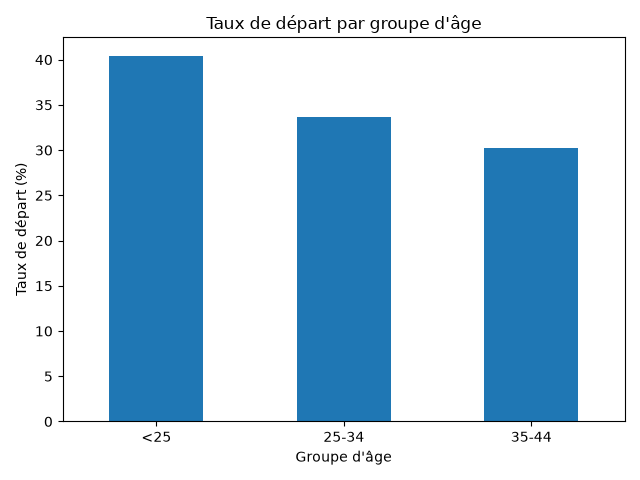
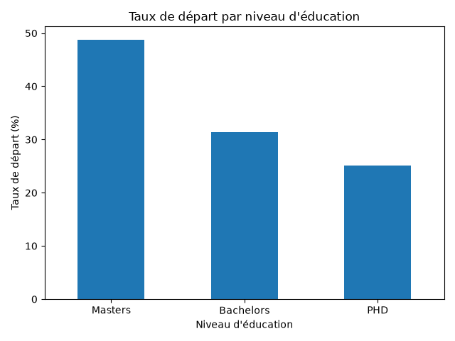
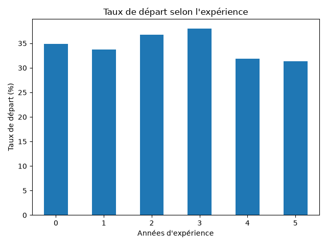
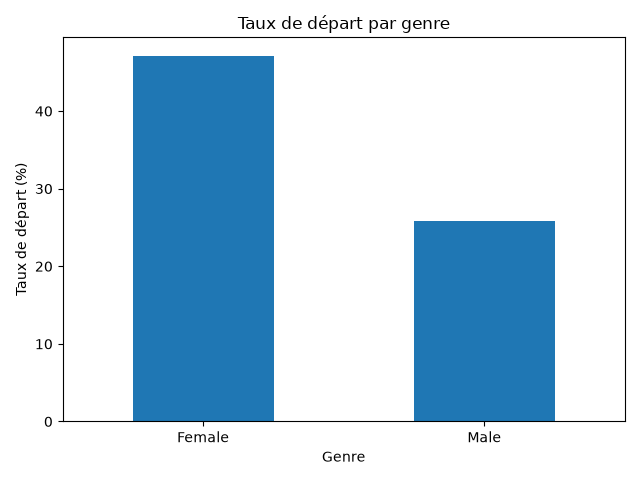
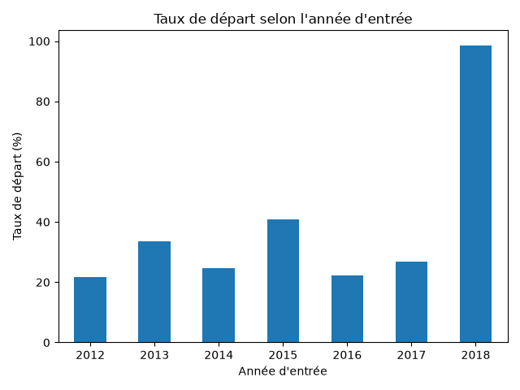

# Employee Churn Analysis

## 📌 Project Overview

This project analyzes employee attrition data to identify patterns and factors associated with employee departures.

The objective is to transform raw employee data into actionable insights through data cleaning, exploratory analysis, business questions, statistical comparisons, and data visualization.


## 📌 Executive Summary

The analysis of 4,653 employee records highlights several important patterns:

- The 2018 joining-year cohort contains 367 records, of which 362 have `LeaveOrNot = 1`, corresponding to 98.64% in this dataset.
- This unusually high proportion is an important finding that requires further investigation.
- `JoiningYear` indicates when an employee joined, not when they left. The available data does not establish the cause of this pattern.
- Employees with a Master's degree have the highest overall attrition rate at **48.80%**.
- Female employees have a higher overall attrition rate (**47.15%**) than male employees (**25.77%**).
- Employees under 25 have the highest overall attrition rate among the age groups.
- Employees with 3 years of experience have the highest attrition rate among the main experience groups (**38.04%**).
- Pune records the highest number of employee departures and one of the highest attrition rates among the cities analyzed.

The strongest finding is the 2018 cohort anomaly. This result should not be interpreted as proof that employees who joined in 2018 necessarily left because of their joining year. Further investigation would be required.

---

## 🎯 Business Problem

Employee turnover can generate significant costs for an organization through recruitment, onboarding, training, and loss of experienced employees.

The goal of this analysis is to investigate whether employee characteristics such as:

- City
- Age
- Education level
- Experience
- Gender
- Joining year

are associated with differences in employee attrition rates.

---

## ❓ Business Questions

The analysis investigates the following questions:

1. Which city has the highest employee departure rate?
2. Is employee age associated with attrition?
3. Does education level influence the departure rate?
4. Is attrition related to experience in the current domain?
5. Is there a difference in departure rates between genders?
6. Does the employee's joining year show any particular attrition pattern?

---

## 📊 Dataset

The dataset contains employee-level information including demographic, professional, and employment-related characteristics.

Main variables used in this analysis include:

| Variable | Description |
|---|---|
| `City` | Employee's city |
| `Age` | Employee's age |
| `Education` | Education level |
| `Gender` | Employee's gender |
| `JoiningYear` | Year the employee joined the company |
| `ExperienceInCurrentDomain` | Years of experience in the current domain |
| `LeaveOrNot` | Whether the employee left the company |

`LeaveOrNot` is the target variable:

- `0` = employee did not leave
- `1` = employee left


## Dataset Source and License

- **Dataset:** [Employee Dataset](https://www.kaggle.com/datasets/tawfikelmetwally/employee-dataset)
- **Dataset author:** Tawfik Elmetwally
- **Platform:** Kaggle
- **License:** [CC0 1.0 Universal](https://creativecommons.org/publicdomain/zero/1.0/)

This project uses the dataset for educational and portfolio purposes.

The analysis, data visualizations, and interpretations presented in this repository are my own work, based on the source dataset.

Please refer to the original dataset page and its licensing information for the applicable terms.


## 🔍 Data Analysis

The analysis followed several steps:

1. Dataset loading
2. Dataset structure inspection
3. Missing-value analysis
4. Duplicate analysis
5. Category inspection
6. Business-question formulation
7. Grouped analysis using Pandas
8. Attrition-rate calculation
9. Cross-tabulation
10. Visualization
11. Interpretation and identification of limitations

---

## 📈 Visualizations

The project contains six main visualizations.

### 1. Attrition rate by city


### 2. Attrition rate by age group



### 3. Attrition rate by education level



### 4. Attrition rate by experience



### 5. Attrition rate by gender



### 6. Attrition rate by joining year



---

## 🧠 Key Findings

### Joining year is the strongest anomaly

The most notable pattern appears for employees with:

`JoiningYear = 2018`

There are 367 employees in this cohort, of whom 362 are recorded with `LeaveOrNot = 1`, corresponding to an attrition rate of approximately **98.64%**.

This is substantially higher than the rates observed for the other joining-year cohorts.

However, `JoiningYear` represents the year an employee joined the company. It should therefore **not** be interpreted as the year in which the employee left.

This pattern may indicate a cohort effect, a dataset construction issue, or an observation-window effect and would require further investigation.

### Age

Employees under 25 have the highest overall departure rate.

However, the 2018 cohort shows extremely high departure rates across the different age groups, meaning age alone does not explain the 2018 anomaly.

### Education

Employees with a Master's degree have the highest overall departure rate.

Bachelor's degree holders account for the largest number of departures because they represent the largest group in the dataset.

### Experience

Employees with three years of experience have the highest overall departure rate.

The relationship between experience and attrition is not monotonic, so the data does not support the simple conclusion that more experience automatically leads to lower attrition.

### Gender

Female employees have a higher overall departure rate than male employees in this dataset.

However, the difference becomes very small within the 2018 cohort, where both groups have departure rates close to 99%.

### City

Pune records a particularly high number and rate of departures.

However, city alone does not explain the overall attrition pattern, and additional variables need to be considered.

---

## ⚠️ Limitations

This analysis identifies associations in the dataset. It does not establish causality.

Several conclusions should therefore be interpreted carefully.

In particular:

- `JoiningYear` is not the employee's departure year.
- The 2018 cohort is unusually small compared with some other cohorts.
- The extremely high 2018 attrition rate may indicate a data or observation-window effect.
- Some experience categories contain very few observations.
- Observational data cannot by itself explain why employees leave.
- Additional variables would be required to investigate potential causes such as salary, management, workload, job satisfaction, promotion opportunities, or working conditions.

---

## 🛠️ Technologies Used

- Python
- Pandas
- Matplotlib
- VS Code
- Git
- GitHub


---
## How to run

### 1. Clone the repository
=> Bash 
git clone https://github.com/chrono-byte238/Employee-Churn-Analysis.git
cd Employee-Churn-Analysis

### 2. Install Dependencies
=> Bash
python -m pip install -r requirements.txt

### 3. Run the analysis
=> Bash
python notebooks/churn_analysis.py

### 4. Generate the visualizations
=> Bash
python notebooks/visualization.py

---

## 🚀 Future Improvements

Possible extensions of this project include:

- Investigating the 2018 cohort anomaly in greater depth
- Adding salary and payment-related variables
- Studying interactions between age, experience and education
- Adding statistical significance tests
- Building an interactive dashboard
- Adding SQL-based analysis
- Building an employee attrition prediction model
- Comparing several machine learning models
- Deploying the final analysis as a web application
---

## 👤 Author

**Alan Ngang a.k.a Chronos**

Aspiring Data Analyst / Python Developer

Interested in:

- Data Analysis
- Python
- Machine Learning
- Automation
- Software Engineering

📌 GitHub: <https://github.com/chrono-byte238>
📌 LinkedIn: <https://www.linkedin.com/in/alan-ngang-5295a338a>
---
## 📁 Project Structure

```text

Employee-Churn-Analysis/
├── data/
│   └── Employee.csv
├── notebooks/
│   ├── churn_analysis.py
│   └── visualization.py
├── outputs/
│   └── Figures/
│       ├── 1_City_Attrition.png
│       ├── 2_Age_group_Attrition.png
│       ├── 3_Education_Attrition.png
│       ├── 4_Experience_Attrition.png
│       ├── 5_Gender_Attrition.png
│       └── 6_Joining_year_Attrition.png
├── .gitignore
├── README.md
└── requirements.txt

